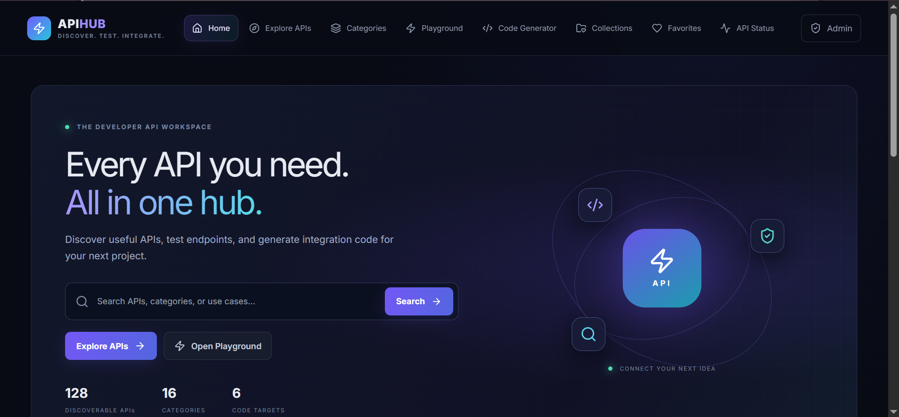
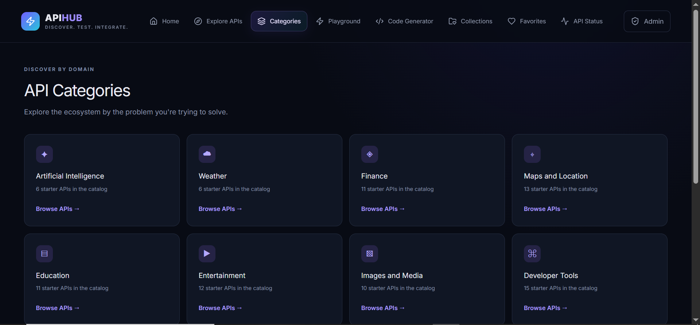
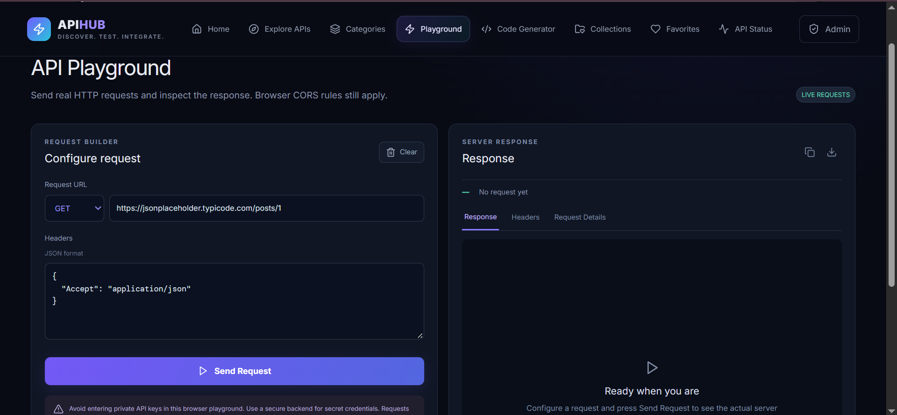

# ✦ APIHUB — Discover. Test. Integrate.


**Your all-in-one workspace for discovering, exploring, and working with APIs.**

Welcome to **APIHUB**, a developer-focused API discovery platform designed to make finding and experimenting with APIs easier. Browse a curated API directory, explore categories, inspect API information, test endpoints in an interactive playground, generate request code, and organize useful APIs into favorites and collections.

Whether you're learning how APIs work, prototyping an application, or looking for a service to integrate into a project, APIHUB brings useful discovery and development tools together in one place.

**Discover APIs. Test ideas. Build faster.**

---

## 📸 Application Preview

Explore the different sections of APIHUB through the screenshots below.

### 01 — Home Dashboard


### 02 — Explore APIs


### 03 — API Categories


### 04 — API Playground


### 05 — Code Generator


### 06 — Favorites


### 07 — Collections


### 08 — API Status


### 09 — Admin and Submissions


---

## 🎯 Project Overview

APIHUB combines API discovery and development utilities into one workspace. Instead of searching through multiple websites and tools, developers can explore APIs, review their details, experiment with requests, and organize useful resources through a single interface.

The basic workflow:

1. Browse the API directory.
2. Search and filter APIs by category.
3. Open an API to review its information.
4. Experiment with endpoints using the Playground.
5. Generate code snippets for API requests.
6. Save useful APIs to Favorites.
7. Organize APIs into personal Collections.
8. Monitor API availability through the status section.

APIHUB aims to make API exploration more accessible, organized, and convenient for developers.

---

## ✨ Features

### 🏠 Home Dashboard
- View an overview of the APIHUB platform.
- Discover featured and popular APIs.
- Access important platform sections.
- Navigate through the application using its main navigation.

### 🔎 Explore APIs
- Browse a collection of APIs.
- Search for APIs by name or keyword.
- Discover different API services.
- View API descriptions and relevant information.
- Explore available API details.

### 🗂️ Categories
- Browse APIs by category.
- Discover services based on their purpose.
- Explore different areas of API development.
- Find APIs relevant to your projects.

### 🧪 API Playground
- Experiment with API requests.
- Enter an endpoint to test.
- Configure request details.
- Inspect API responses.
- Review request results and errors.

### 💻 Code Generator
- Generate API request code.
- Use generated snippets as a starting point for integrations.
- Reduce repetitive request-writing tasks.
- Make it easier to incorporate APIs into development projects.

### ⭐ Favorites
- Save APIs you want to revisit.
- Keep useful services in one place.
- Access saved APIs more conveniently.

### 📚 Collections
- Organize APIs into collections.
- Group useful services based on your projects or interests.
- Keep API resources organized.

### 📡 API Status
- Access the API status section.
- Review available API status information.
- Check service availability where supported.

### 🛠️ Admin and Submissions
- Access the administration and submission interface.
- Support API submission workflows.
- Provide a place for managing API directory contributions.

### 💾 Data Storage
- Uses browser storage for supported locally saved information.
- Provides a storage utility for application data.
- Includes Supabase integration files for backend functionality.

---

## 🛠️ Built With

| Technology | Purpose |
|---|---|
| React | Component-based user interface |
| TypeScript | Type safety and application logic |
| Vite | Development server and build tooling |
| Tailwind CSS | Utility-first styling |
| Supabase | Backend and database integration |
| Lucide Icons | Interface icons |
| JavaScript | Runtime functionality |
| CSS | Layout, styling, and responsive design |

### Development Tools
- Visual Studio Code
- Node.js and npm
- Git and GitHub
- Modern web browser

---

## 🚀 Getting Started

You can run APIHUB locally by installing its project dependencies and starting the Vite development server.

### Prerequisites

Make sure you have:

- A computer running Windows, macOS, or Linux.
- [Node.js](https://nodejs.org/) installed.
- npm (included with Node.js).
- Visual Studio Code or another code editor.
- Git (optional).
- An internet connection for external API requests.

### Installation

**1. Clone the repository**

```bash
git clone https://github.com/rheillunio2-byte/APIHub.git
```

**2. Navigate to the project folder**

```bash
cd APIHub
```

**3. Install dependencies**

```bash
npm install
```

If you're using Windows PowerShell and encounter an execution policy error with `npm`, use:

```powershell
npm.cmd install
```

**4. Start the development server**

```bash
npm run dev
```

On Windows PowerShell, you can also use:

```powershell
npm.cmd run dev
```

**5. Open APIHUB**

Vite will display a local development URL in your terminal, usually:

```text
http://localhost:5173
```

Open the displayed URL in your browser.

**6. Start exploring!**

Browse APIs, experiment with requests, generate code, and organize your favorite services.

---

## 🕹️ How to Use

1. Launch APIHUB.
2. Explore the Home dashboard.
3. Navigate to Explore APIs.
4. Search for an API that fits your project.
5. Browse Categories to discover related services.
6. Open an API to review its information.
7. Use the Playground to experiment with API requests.
8. Use the Code Generator to create request snippets.
9. Save useful APIs to Favorites.
10. Organize related APIs into Collections.
11. Visit API Status to review available status information.
12. Explore Admin and Submissions where applicable.

**Tip:** Before integrating an API into your project, review its documentation, authentication requirements, rate limits, and usage policies.

---

## 🔌 API Integration

APIHUB is designed to help developers discover and experiment with external APIs.

When working with an API, keep the following in mind:

- Check the API's official documentation.
- Verify the correct endpoint and HTTP method.
- Include required request headers and parameters.
- Check whether authentication is required.
- Handle unsuccessful responses and network errors.
- Respect API rate limits.
- Avoid exposing private API keys in frontend code.
- Review the API provider's terms of service.

### Important Notes

- API availability depends on the external provider.
- Some APIs may require API keys or authentication.
- Some services may restrict browser-based requests through CORS policies.
- API rate limits may affect request results.
- A successful request in the Playground does not guarantee that an API will always be available.

---

## 📂 Project Structure

```text
APIHub/
│
├── public/
│
├── images/
│   ├── Admin and Submissions.PNG
│   ├── API Status.PNG
│   ├── Categories.PNG
│   ├── Code Generator.PNG
│   ├── Collections.PNG
│   ├── Explore APIs.PNG
│   ├── Favorites.PNG
│   ├── Home.PNG
│   └── Playground.PNG
│
├── src/
│   ├── components/
│   │   ├── common/
│   │   └── layout/
│   │
│   ├── data/
│   │   └── apis.ts
│   │
│   ├── hooks/
│   │   └── useLocalState.ts
│   │
│   ├── lib/
│   │   ├── storage.ts
│   │   └── supabase.ts
│   │
│   ├── pages/
│   │   ├── Admin.tsx
│   │   ├── ApiDetails.tsx
│   │   ├── ApiStatus.tsx
│   │   ├── Categories.tsx
│   │   ├── CodeGenerator.tsx
│   │   ├── Collections.tsx
│   │   ├── Explore.tsx
│   │   ├── Favorites.tsx
│   │   ├── Home.tsx
│   │   └── Playground.tsx
│   │
│   ├── types/
│   │   └── index.ts
│   │
│   ├── App.tsx
│   ├── index.css
│   ├── main.tsx
│   └── vite-env.d.ts
│
├── supabase/
│   ├── functions/
│   │   └── secure-proxy/
│   │       └── index.ts
│   └── migrations/
│       └── 0001_initial_schema.sql
│
├── .env.example
├── .gitignore
├── CONTRIBUTING.md
├── index.html
├── package.json
├── postcss.config.js
├── README.md
├── tailwind.config.js
├── tsconfig.app.json
├── tsconfig.json
├── tsconfig.node.json
└── vite.config.ts
```

### Main File Responsibilities

- `src/App.tsx` - Main application component and page routing.
- `src/main.tsx` - Application entry point.
- `src/index.css` - Global styles.
- `src/components/` - Reusable interface components.
- `src/pages/` - Main application pages.
- `src/data/apis.ts` - API directory data.
- `src/hooks/` - Reusable React hooks.
- `src/lib/storage.ts` - Browser storage utilities.
- `src/lib/supabase.ts` - Supabase client configuration.
- `src/types/` - TypeScript type definitions.
- `supabase/` - Database migrations and Edge Functions.
- `images/` - Application screenshots.
- `README.md` - Main project documentation.
- `CONTRIBUTING.md` - Contribution guidelines.
- `.env.example` - Example environment configuration.

---

## 🧠 Project Objectives

APIHUB aims to help developers:

- Discover useful APIs more efficiently.
- Understand how external APIs work.
- Experiment with API requests.
- Generate code for API integrations.
- Organize API resources.
- Reduce repetitive development tasks.
- Explore new tools and services.
- Build projects using external data and services.

---

## ⚠️ Limitations

- External API availability is not controlled by APIHUB.
- Some APIs require authentication or API keys.
- Browser security and CORS restrictions may prevent certain requests.
- API providers may enforce request limits.
- Some API information may need manual updates.
- Locally stored information may not automatically synchronize across devices.
- Backend-dependent features require the appropriate Supabase configuration.
- Generated code may need adjustments before production use.

---

## 🔮 Future Development

Possible improvements and future features include:

- [ ] Expand the API directory.
- [ ] Add more API categories and filters.
- [ ] Improve API documentation previews.
- [ ] Add additional request methods and configuration options.
- [ ] Support more code generation languages.
- [ ] Improve API response formatting.
- [ ] Add request history.
- [ ] Improve API health monitoring.
- [ ] Expand API submission and moderation workflows.
- [ ] Add user authentication.
- [ ] Improve cloud-based collections and favorites.
- [ ] Add API comparison tools.
- [ ] Improve mobile responsiveness.
- [ ] Add more developer utilities.

---

## 🤝 Contributing

Contributions, suggestions, and improvements are welcome!

You can help improve APIHUB by:

- Reporting bugs.
- Suggesting new features.
- Adding useful APIs.
- Improving API information and categorization.
- Enhancing the Playground.
- Improving code generation.
- Improving the user interface.
- Updating documentation.

Please read [CONTRIBUTING.md](CONTRIBUTING.md) before submitting changes.

---

## 🔒 Privacy and Security

APIHUB interacts with external APIs and may use local browser storage and Supabase functionality.

- Do not commit API keys, passwords, or private credentials.
- Keep secret credentials on a secure backend.
- Do not expose service-role keys in frontend code.
- Review the privacy policies of external API providers.
- Avoid storing sensitive personal information.
- Configure Supabase environment variables securely.
- Be aware that clearing browser data may remove locally saved information.

---

## 👨‍💻 Developer

**Developed by RETL**

GitHub: [@rheillunio2-byte](https://github.com/rheillunio2-byte)

APIHUB is an independent project created to make API discovery, testing, and integration more accessible and convenient for developers.

---

## 📜 License

This project is licensed under the MIT License. See the [LICENSE](https://github.com/rheillunio2-byte/APIHub?tab=MIT-1-ov-file) file for details.

---

**Discover APIs. Test ideas. Build faster.** ✦