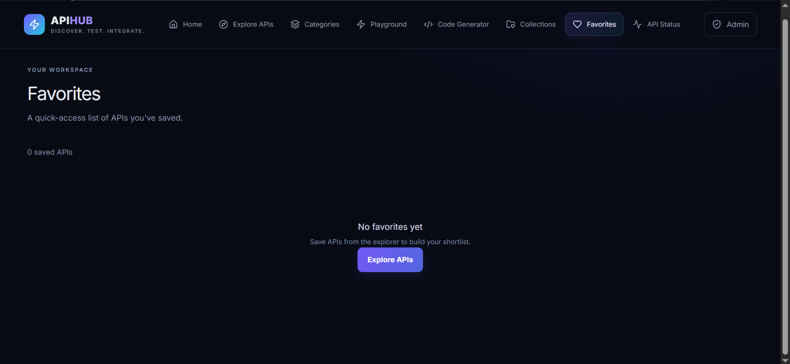
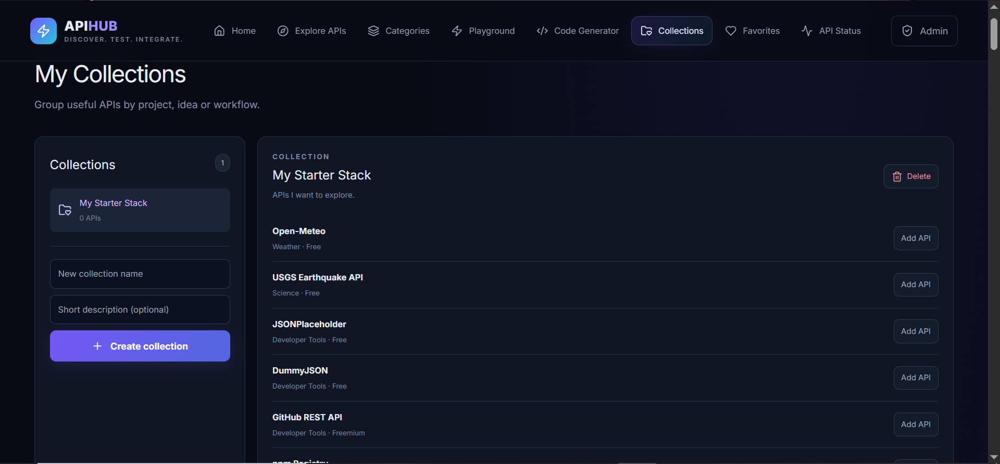
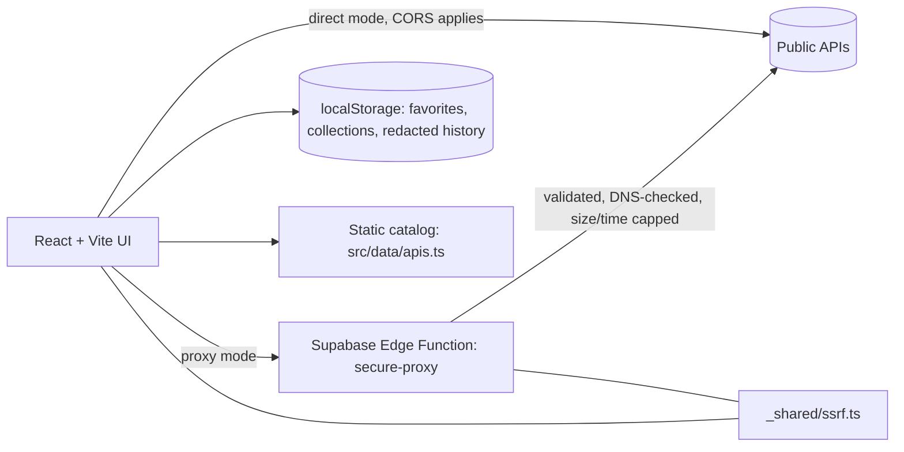

# ✦ APIHUB — Discover. Test. Integrate.


**Your all-in-one workspace for discovering, exploring, and working with APIs.**

Welcome to **APIHUB**, a developer-focused API discovery platform designed to make finding and experimenting with APIs easier. Browse a curated API directory, explore categories, inspect API information, test endpoints in an interactive playground, generate request code, and organize useful APIs into favorites and collections.

Whether you're learning how APIs work, prototyping an application, or looking for a service to integrate into a project, APIHUB brings useful discovery and development tools together in one place.

**Discover APIs. Test ideas. Build faster.**

---

## 📸 Application Preview

Explore the different sections of APIHUB through the screenshots below.

### 01 — Home Dashboard


### 02 — Explore APIs


### 03 — API Categories


### 04 — API Playground


### 05 — Code Generator


### 06 — Favorites


### 07 — Collections


### 08 — API Status


### 09 — Admin and Submissions


---

## 🎯 Project Overview

APIHUB combines API discovery and development utilities into one workspace. Instead of searching through multiple websites and tools, developers can explore APIs, review their details, experiment with requests, and organize useful resources through a single interface.

The basic workflow:

1. Browse the API directory.
2. Search and filter APIs by category.
3. Open an API to review its information.
4. Experiment with endpoints using the Playground.
5. Generate code snippets for API requests.
6. Save useful APIs to Favorites.
7. Organize APIs into personal Collections.
8. Monitor API availability through the status section.

APIHUB aims to make API exploration more accessible, organized, and convenient for developers.

---

## ✨ Features

### 🏠 Home Dashboard
- View an overview of the APIHUB platform.
- Discover featured and popular APIs.
- Access important platform sections.
- Navigate through the application using its main navigation.

### 🔎 Explore APIs
- Browse a collection of APIs.
- Search for APIs by name or keyword.
- Discover different API services.
- View API descriptions and relevant information.
- Explore available API details.

### 🗂️ Categories
- Browse APIs by category.
- Discover services based on their purpose.
- Explore different areas of API development.
- Find APIs relevant to your projects.

### 🧪 API Playground
- Experiment with API requests.
- Enter an endpoint to test.
- Configure request details.
- Inspect API responses.
- Review request results and errors.

### 💻 Code Generator
- Generate API request code.
- Use generated snippets as a starting point for integrations.
- Reduce repetitive request-writing tasks.
- Make it easier to incorporate APIs into development projects.

### ⭐ Favorites
- Save APIs you want to revisit.
- Keep useful services in one place.
- Access saved APIs more conveniently.

### 📚 Collections
- Organize APIs into collections.
- Group useful services based on your projects or interests.
- Keep API resources organized.

### 📡 API Status
- Access the API status section.
- Review available API status information.
- Check service availability where supported.

### 🛠️ Admin and Submissions
- Access the administration and submission interface.
- Support API submission workflows.
- Provide a place for managing API directory contributions.

### ⚖️ Compare APIs
- Compare up to four APIs side by side: category, authentication, pricing model, HTTPS, CORS, documentation and verification status.
- Values come straight from the catalog; no benchmarks, uptime or pricing figures are invented.

### 📖 Developer Resources
- Beginner-friendly guides on REST, HTTP methods, JSON, authentication, error handling and API security, with copyable examples.

### ⌨️ Experience
- Command palette (`Ctrl`/`Cmd` + `K`), dark and light themes, toast notifications, skeleton loading states, keyboard-accessible controls and a skip link.

### 💾 Data Storage
- Uses browser storage for supported locally saved information.
- Provides a storage utility for application data.
- Includes Supabase integration files for backend functionality.

---

## 🛠️ Built With

| Technology | Purpose |
|---|---|
| React | Component-based user interface |
| TypeScript | Type safety and application logic |
| Vite | Development server and build tooling |
| Tailwind CSS | Utility-first styling |
| Supabase | Backend and database integration |
| Lucide Icons | Interface icons |
| JavaScript | Runtime functionality |
| CSS | Layout, styling, and responsive design |

### Development Tools
- Visual Studio Code
- Node.js and npm
- Git and GitHub
- Modern web browser

---

## 🚀 Getting Started

The application lives in the `apihub/` folder of this repository.

### Prerequisites

- [Node.js](https://nodejs.org/) 22 or newer (see `apihub/.nvmrc`) and npm.
- Optional: a [Supabase](https://supabase.com/) project, only needed for the secure proxy and database features.

### Install and run

```bash
git clone https://github.com/rheillunio2-byte/APIHub.git
cd APIHub/apihub
npm install
cp .env.example .env.local   # optional; the app runs without it
npm run dev                  # http://localhost:5173
```

On Windows PowerShell, use `npm.cmd` if script execution is restricted:

```powershell
npm.cmd install
npm.cmd run dev
```

### Environment variables

All values are placeholders in `apihub/.env.example`. Never commit real credentials.

| Variable | Where | Purpose |
|---|---|---|
| `VITE_SUPABASE_URL`, `VITE_SUPABASE_ANON_KEY` | Browser | Enables "APIHub proxy" mode in the Playground and Status page. The anon key is designed to be public; the service-role key must never go in a `VITE_*` variable. |
| `VITE_SITE_URL` | Build | Generates `sitemap.xml` and canonical URLs. Skipped when empty. |
| `ALLOWED_ORIGINS`, `PROXY_RATE_LIMIT`, `PROXY_RATE_WINDOW_SECONDS` | Edge function secrets | Origin allow-list and per-client rate limit for `secure-proxy`. Set with `supabase secrets set`. |

Without Supabase variables the app still works: the Playground sends requests directly from the browser (CORS applies) and the proxy option is shown as not configured.

## 🧪 Testing

```bash
cd apihub
npm test          # 57 unit/integration tests (node:test, no extra dependencies)
npm run typecheck # tsc -b
npm run build     # sitemap + type check + production build
npm run test:sql  # Row Level Security tests; needs a local PostgreSQL (see tests/sql/run.sh)
```

What the tests cover: catalog filtering, sorting and pagination; catalog data quality (no duplicates, valid URLs, https flag consistency, no secrets in examples); code generation with credential masking; request history redaction; verification state classification; storage sanitising; the SSRF validator (private ranges, IPv6 forms, hostile hostnames, redirects) and the real `secure-proxy` handler (origin checks, DNS-rebinding defence, redirect re-validation, size caps, rate limits).

There are **no browser/component/end-to-end tests yet**; the UI is verified manually. See [Limitations](#️-limitations).

## 🛡️ Security model

- Playground and status checks validate every URL on the client **and** again on the server. Localhost, private ranges, link-local/cloud-metadata addresses, credentials in URLs, non-standard ports and non-HTTP schemes are refused.
- The `secure-proxy` edge function resolves DNS itself and rejects hostnames that point at private space, re-validates every redirect hop, caps response size and time, drops `Set-Cookie`, enforces an origin allow-list and rate-limits per client.
- Request history redacts credential headers, sensitive query parameters and JSON keys **before** anything is written to `localStorage`. Generated code replaces credentials with `YOUR_API_KEY`.
- Response content is rendered as text nodes, never as HTML.
- Supabase migrations enable Row Level Security (verified by `tests/sql`).
- Known limit: DNS is resolved by the proxy and again by `fetch`, so DNS rebinding is mitigated but not impossible; deploy behind an egress firewall for defence in depth. This is not a claim that the application is completely secure.

## 🏗️ Architecture



The SSRF rules live in one file (`supabase/functions/_shared/ssrf.ts`) shared by browser and server so they cannot drift. Pure logic (`src/lib/*`) has no React dependency and is covered by the unit tests. More detail in [docs/ARCHITECTURE.md](apihub/docs/ARCHITECTURE.md).

## 🗂️ Catalog data

The catalog is a typed list in `apihub/src/data/apis.ts`. Every entry starts as **"Needs review"** with **"Not recently verified"**; nothing is marked verified without a verification date (enforced by tests). Pricing and authentication values are taken from each provider's public documentation and may change, so confirm with the provider. Categories are a plain list in the same file; add a category there and use it on at least one entry (a test enforces both directions). To contribute an API, see [CONTRIBUTING.md](CONTRIBUTING.md).

## ☁️ Deployment

**Frontend (Vercel):** import the repository, set **Root Directory** to `apihub`, framework preset *Vite*. `vercel.json` provides SPA rewrites, security headers and long-lived asset caching. Set `VITE_SITE_URL` (and the Supabase variables if you use the proxy).

**Backend (optional):**

```bash
supabase link --project-ref YOUR-PROJECT-REF
supabase db push                                  # applies migrations 0001 and 0002
supabase secrets set ALLOWED_ORIGINS=https://your-site.vercel.app
supabase functions deploy secure-proxy
```

Keep JWT verification enabled for the function (the default); the browser client sends the anon key.

## 🩺 Troubleshooting

| Symptom | Cause / fix |
|---|---|
| Playground shows "browser could not complete the request" | Almost always CORS. Use "APIHub proxy" mode if configured. |
| "APIHub proxy (not configured)" | `VITE_SUPABASE_URL` / `VITE_SUPABASE_ANON_KEY` are missing or the dev server was not restarted after editing `.env.local`. |
| Proxy returns 403 | Your site's origin is not listed in `ALLOWED_ORIGINS`. |
| Proxy returns 429 | Per-client rate limit reached; wait for `Retry-After`. |
| `npm test` fails with "unknown option --experimental-strip-types" | Use Node 22.6 or newer. |
| Favorites from an older version disappeared | Merged duplicate entries are migrated automatically; clearing site data resets all local state. |

## ⚠️ Limitations

- External API availability, CORS and rate limits are outside APIHub's control.
- Favorites, collections and history are stored per browser; there is no account sync.
- The admin page is a local demo, not an authenticated console. Do not expose real moderation actions until Supabase Auth and role checks are configured.
- The catalog is small and unverified by default; there is no automated link-checking job yet.
- The edge function's rate limiter is in-memory per isolate, a best-effort brake rather than a global quota.
- There are no browser-level (component or end-to-end) tests yet, and the screenshots in `images/` may predate the latest UI changes.

## 🔮 Roadmap

- [ ] Scheduled verification job that records real check results and dates.
- [ ] Playwright end-to-end tests for search, filters, playground, favorites, collections and theme switching.
- [ ] Authenticated persistence for favorites and collections via Supabase.
- [ ] Broader catalog with provider-licensed data and attribution.
- [ ] Refreshed screenshots.

## 🤝 Contributing

Contributions, suggestions, and improvements are welcome. Please read [CONTRIBUTING.md](CONTRIBUTING.md) before submitting changes.

## 👨‍💻 Project links

- Website: [APIHUB](https://api-hub-puce.vercel.app/)
- Developer: [@rheillunio2-byte](https://github.com/rheillunio2-byte)

## 📄 License

MIT. See [LICENSE](LICENSE).
